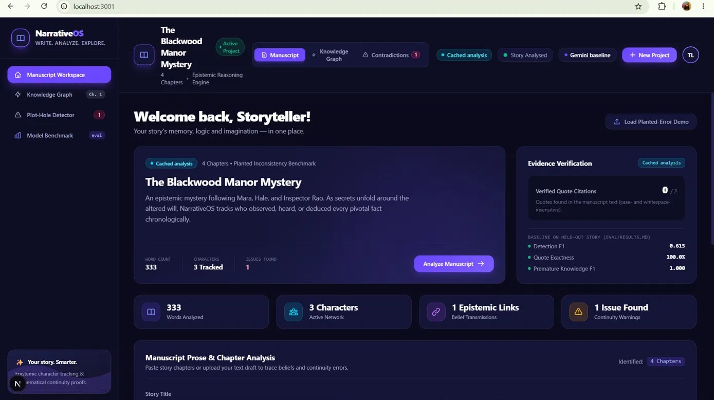
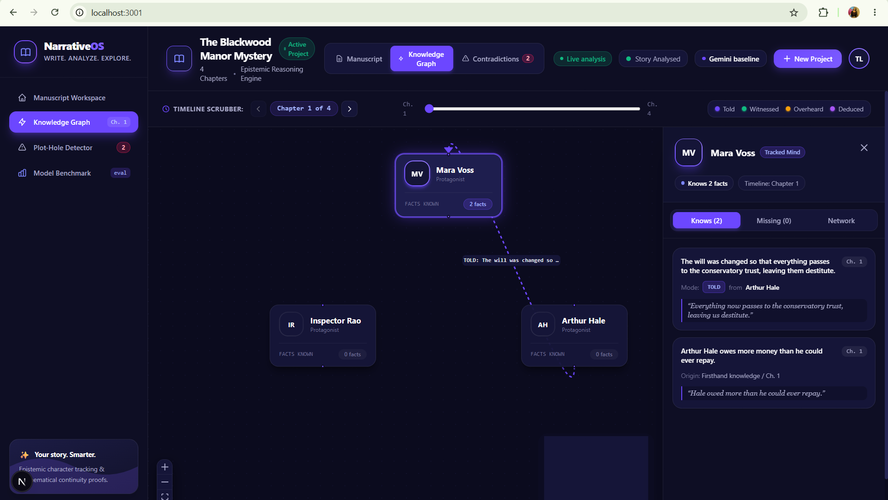
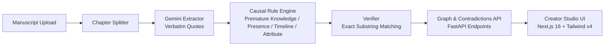
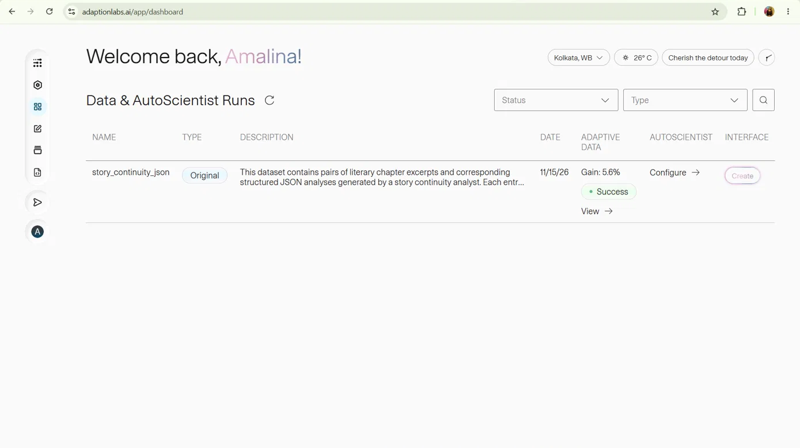
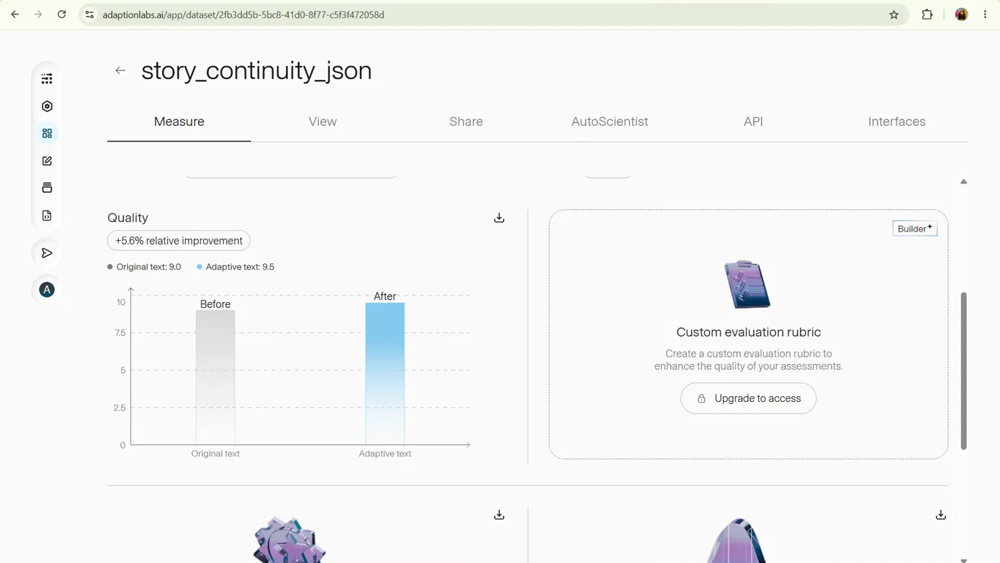

# NarrativeOS — Story-Continuity & Epistemic Reasoning Engine

> **Catch plot holes and track who knows what across long manuscripts — with verbatim evidence, never rewriting author prose.**

---

## 1. Problem & Solution

- **The Problem:** Fiction authors lose track of *who knows what, when, and from whom* as manuscripts expand across multiple POV chapters. General AI tools generate new prose; none reason formally over character belief states to catch subtle continuity contradictions.
- **The Solution:** NarrativeOS acts as an epistemic reasoning engine. It builds a chapter-by-chapter character knowledge graph with an interactive timeline scrubber and flags continuity paradoxes with exact evidence passages. The engine preserves 100% author control and **never edits or rewrites the manuscript**.

---

## 2. Screenshots

| Manuscript Workspace | Knowledge Graph & Scrubber |
|---|---|
| <br>*Manuscript Workspace: Prose analysis view tracking text metrics and chapter boundaries.* | <br>*Knowledge Graph: Visualizing character epistemic states across chapters with timeline scrubbing.* |
| **Contradiction Detector** | **Adaption Adaptive Data Dashboard** |
| <br>*Contradiction Detector: Flagged continuity conflicts grounded with exact quotation evidence.* | <br>*Adaption Dashboard: Adaptive Data optimization run and metric verification.* |

---

## 3. Architecture & How It Works



### How It Works
1. **Chapter Split:** Ingests raw manuscript prose (`.txt` / `.docx`) and segments it into discrete narrative chapters via regex markers.
2. **Gemini Extraction:** Extracts character knowledge acquisitions with required verbatim prose quotes (`witnessed`, `told`, `overheard`, `read`, `deduced`).
3. **Causal Rule Engine:** Pure Python logic checks for premature knowledge, presence violations, timeline paradoxes, and attribute drift without LLM hallucinations.
4. **Exact-Substring Verifier:** Verifies every flagged evidence quote exists as a character-for-character substring of the manuscript text before alerting.

---

## 4. Measured Evaluation (eval/results.md)

Evaluated against our 6-chapter held-out evaluation story (`data/test_story.txt`) containing 8 planted ground-truth errors (`data/answer_key.json`):

### Overall Performance
| Metric | Value |
|---|---|
| **Detection F1** | **0.615** |
| **Precision** | 0.800 |
| **Recall** | 0.500 |
| **Quote exactness** | **100.0%** |
| **JSON validity** | 100.0% |
| **Avg latency** | 2.07s |

### Per-Contradiction Type Performance
| Contradiction Type | Precision | Recall | F1 Score |
|---|---|---|---|
| **premature_knowledge** | 1.000 | 1.000 | **1.000** |
| **attribute** | 1.000 | 0.500 | **0.667** |
| **presence** | 0.500 | 0.500 | **0.500** |
| **timeline** | 0.000 | 0.000 | **0.000** |

### Run Benchmark Commands
The scripts resolve repository paths from their location and execute from the repository root:
```powershell
# One-shot benchmark (upload -> analyze -> evaluate):
python eval/submit_and_eval.py --extractor gemini

# Standalone evaluation against an existing manuscript ID:
python eval/run_eval.py --manuscript-id <mid> --extractor gemini

# Alternatively using the virtualenv python:
.\api\.venv\Scripts\python.exe eval\submit_and_eval.py --extractor gemini
```

### Limitations
- **Planted-Error Benchmark is Small:** Evaluated on a single 6-chapter held-out story (8 planted errors); timeline detection finds 0 of 2 planted errors (recall 0.0), and presence recall is partial (0.500). We do not claim general accuracy across diverse fiction genres without larger testing.
- **Adaption Pilot Scope:** The Adaption integration was a 3-row Adaptive Data dataset refinement pilot, **not a fine-tuned model**. No fine-tuned adapter weights exist or have been evaluated.
- **Cached Extractions:** Results shown on screen may come from a cached extraction of a real Gemini run rather than dynamic live LLM inference when running without an active API key or re-analyzing previously processed text.

---

## 5. Truthful Data-Source Indicators

The UI displays an honest data-source badge at all times:
- **`Built-in sample (mock)`**: Default view rendering static demo data bundled with the app (`contracts/mock` or `mockData.ts`).
- **`Cached analysis`**: Real extracted and verified data served from the backend storage cache.
- **`Live analysis`**: Real data actively extracted and verified via API calls in the current session.

The badge may read 'Live analysis' when the backend returned results for the analyzed text; if that text was analyzed before, the backend serves its cached extraction of a real Gemini run.

> *Note:* Analyzing new or custom manuscripts requires the user's own `GEMINI_API_KEY` configured in `.env`.

---

## 6. Adaption Labs Integration (Pilot)

We piloted Adaption's Adaptive Data platform to evaluate and refine extraction training data for narrative continuity:
- **Dataset ID:** `2fb3dd5b-5bc8-41d0-8f77-c5f3f472058d` (from `data/adaption/adaption_state.json`)
- **Adaptive Data Pass:** 3 rows submitted / 3 rows adapted; Grade: **A → A**, Quality Score: **9.0 → 9.5** (**+5.6% relative improvement** in 159s).
- **Audit & Evidence:** Detailed audit and leakage checks in [`docs/adaption_results.md`](docs/adaption_results.md).
- **Scope Disclaimer:** This was strictly an Adaptive Data pilot on seed data, **not a trained or fine-tuned model**. The backend includes an `EXTRACTOR=adapted` toggle for future pipeline drop-in, but no adapted model weights have been evaluated. Next steps: expand training data, fine-tune model weights, and benchmark against held-out ground truth.

| Adaption Dataset Overview | Adaption Evaluation Grade |
|---|---|
| <br>*Adaption Dataset: 3-row seed dataset uploaded and processed via Adaptive Data.* | <br>*Adaption Evaluation: Grade A → A, percentile 43.9 → 57.7, as shown on the Adaption dashboard.* |

---

## 7. Tech Stack & Dependencies

- **Frontend Dependencies (`web/package.json`):** Next.js `16.4.6`, React `19.3.0`, React DOM `19.3.0`, `@xyflow/react` `^12.12.1`, Tailwind CSS `^4.3.3`, `@tailwindcss/postcss` `^4.3.5`
- **Backend Dependencies (`api/requirements.txt`):** Python (3.12, per `render.yaml`), `fastapi`, `uvicorn[standard]`, `pydantic`, `python-dotenv`, `python-multipart`, `python-docx`, `google-genai`, `pytest`, `httpx`
- **Environment Variable Names:**
  - Root `.env`: `GEMINI_API_KEY`, `EXTRACTOR`, `ADAPTION_API_KEY` (placeholder)
  - `web/.env.local`: `NEXT_PUBLIC_API_URL`, `NEXT_PUBLIC_USE_MOCK`

---

## 8. Setup & Quickstart

### 1. Clone & Configure
```bash
git clone https://github.com/shreejato/who-knew-what.git
cd who-knew-what
# Linux/macOS: cp .env.example .env
# Windows PowerShell: Copy-Item .env.example .env
```
> **Note:** `.env.example` contains variable names with placeholder values (`GEMINI_API_KEY`, `EXTRACTOR`, `ADAPTION_API_KEY`). When no key is set, the engine operates using cached extractions and substring verification rules.

### 2. Backend (FastAPI)
```powershell
cd <repo>\api
python -m venv .venv
.\.venv\Scripts\Activate.ps1
pip install -r requirements.txt
uvicorn app.main:app --reload --port 8000
```
Verify: Open [http://localhost:8000/docs](http://localhost:8000/docs) in your browser.

### 3. Frontend (Next.js)
```powershell
cd <repo>\web
npm install
npm run dev
```
Verify: Open [http://localhost:3000](http://localhost:3000) in your browser.

*Production build on Windows (bypasses Turbopack child-process issue):*
```powershell
npm run build -- --webpack
```

---

## 9. Project Structure

```
├── api/           FastAPI server (extraction, rules, verifier, routes)
│   └── app/
│       ├── extraction/   GeminiExtractor · AdaptedExtractor · factory
│       ├── rules/        premature_knowledge · presence · timeline · attribute
│       └── verifier/     quote-exact contradiction verifier
├── contracts/     schema.json + mock payloads
├── data/
│   ├── test_story.txt      6-chapter planted-error test story (held-out, never trained on)
│   ├── answer_key.json     8 known errors with verbatim quotes
│   ├── gutenberg/          Public-domain source chapters
│   └── adaption/           Adaptive Data seed dataset + pipeline
├── docs/
│   ├── screenshots/        Application screenshots (.jpg/.png)
│   ├── adaption_results.md Adaptive Data pilot audit & results
│   └── DEPLOYMENT_AND_SUBMISSION.md Deployment & submission guide
├── eval/
│   ├── submit_and_eval.py  One-shot benchmark runner
│   ├── run_eval.py         Standalone manuscript eval runner
│   └── results.md          Benchmark output
└── web/           Next.js studio (upload, knowledge graph, contradiction panel)
```

---

## 10. Team

| Member | Name | Handle | Role | Responsibilities |
|---|---|---|---|---|
| Member 1 | TODO: add name | @saptadeepa823 | AI & Backend Lead | Extraction pipelines, causal rule engine, verifier & FastAPI services |
| Member 2 | TODO: add name | @prantikmondal433-hub | Frontend Lead | Next.js architecture, React Flow knowledge graph, interactive scrubber |
| Member 3 | TODO: add name | @shreejato | Data & Evaluation Lead | Planted-error test suite, Adaption workflow, benchmark evaluation |
| Member 4 | TODO: add name | @amalinaguin-2006 | Team Lead, UI Designer and Problem Solver | Architecture direction, design system tokens, end-to-end integration & verification |
