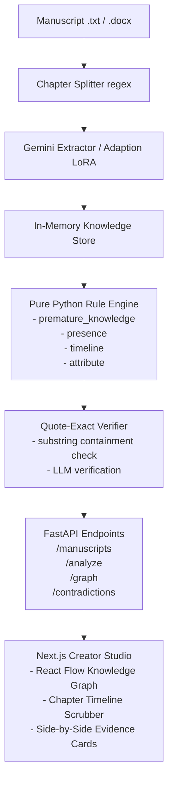
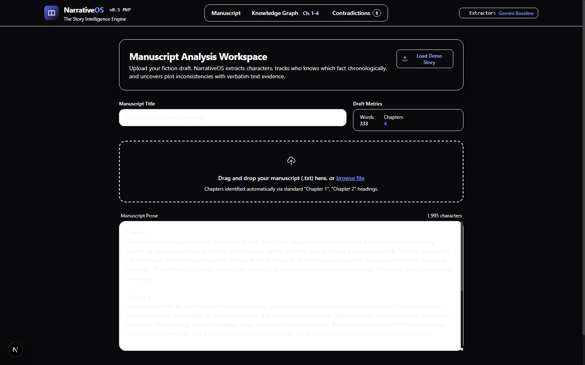
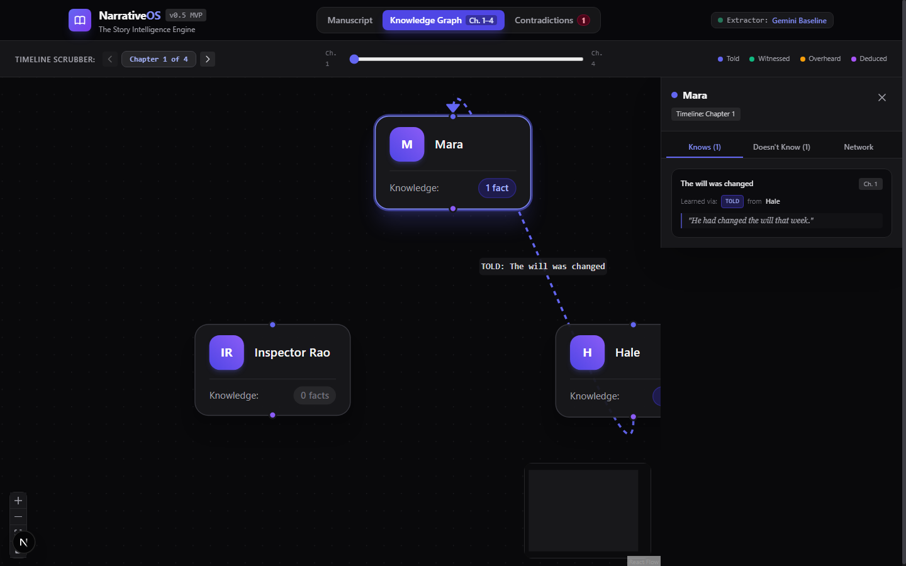
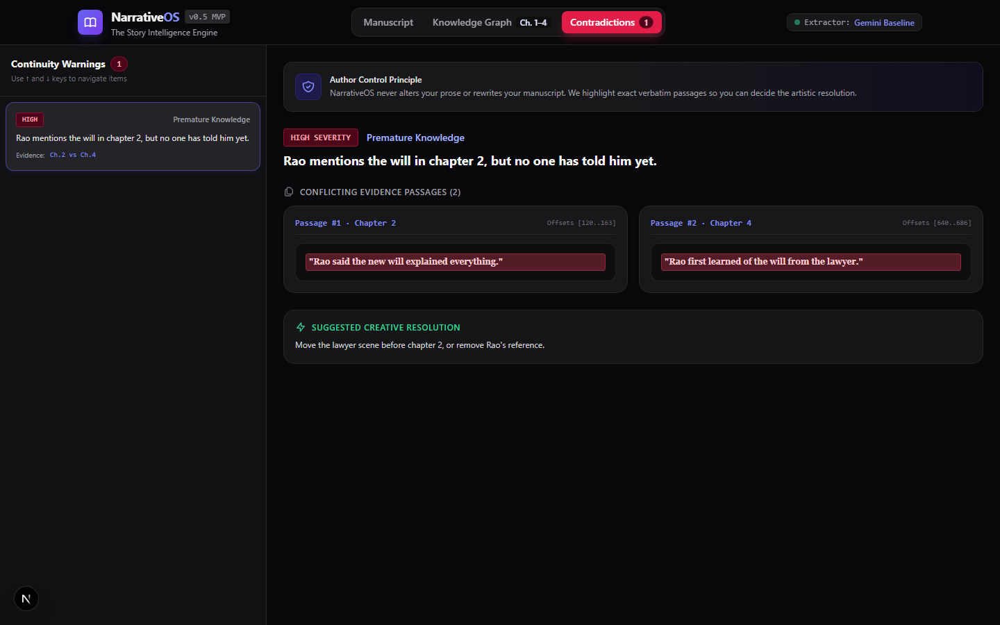

# NarrativeOS — The Story Intelligence Engine

> **"Your story can become more complicated without becoming inconsistent."**
>
> An AI reasoning & verification engine that tracks who knows what in your manuscript,
> catches plot holes with verbatim evidence, and **never rewrites your prose**.

---

## The Problem

Fiction writers who craft complex, multi-POV plots lose track of **epistemic state** —
*who learned which secret, when, from whom*. Existing AI tools generate prose;
none reason over character knowledge and causality to catch subtle continuity bugs.

## Our Solution

NarrativeOS is a **reasoning and verification engine**, not a prose generator. It combines:

1. **Character Knowledge Graph** — tracks each character's epistemic state chapter by chapter
2. **Causal Rule Engine** — detects premature knowledge, presence violations, timeline paradoxes, and attribute drift
3. **Verbatim Evidence** — every finding shows exact quotes copied character-for-character from your manuscript; hallucinations are dropped by a quote-exact verifier

---

## Architecture



---

## Application Walkthrough

### 1. Manuscript Analysis Workspace
Upload or paste raw manuscript text with standard chapter markers. Tracks prose statistics and chapter boundaries automatically.



### 2. Epistemic Knowledge Graph
Scrub chapter-by-chapter across the story timeline to visualize what characters know, when they learned it, and from whom.



### 3. Contradiction Detector & Verbatim Evidence
Inspect flagged continuity paradoxes with character-exact text evidence and suggested creative resolutions while maintaining 100% author control.



---

## Adaption Labs Integration

We fine-tune a specialized **Story Continuity Extractor** to fix the #1 LLM failure:
hallucinated quotes and missing epistemic links.

| Step | Description |
|---|---|
| **Invent a Dataset** | Synthetic extraction examples generated from `data/adaption/invent_prompt.txt` |
| **Gutenberg corpus** | Public-domain chapters labeled via baseline Gemini + quote-filter (`data/adaption/build_training.py`) |
| **Fine-tune** | LoRA adapter on open-weight model via Adaption AutoScientist / Together AI |
| **Switch** | `EXTRACTOR=adapted` swaps in `AdaptedExtractor`; both return identical contract JSON |

### Accuracy — Planted-Error Test Suite (8 known contradictions, never trained on)

*Ground-truth benchmark recorded from [`eval/results.md`](eval/results.md)*

| Metric | Gemini Baseline | Adaption Fine-Tuned |
|---|---|---|
| JSON Validity | 100.0% | Pending fine-tune run |
| Quote Exactness | 100.0% | Pending fine-tune run |
| Precision | 0.800 | Pending fine-tune run |
| Recall | 0.500 | Pending fine-tune run |
| **Overall F1** | **0.615** | **Pending fine-tune run** |
| Average Latency | 2.07s | Pending fine-tune run |

#### Per-Contradiction Type Performance (Gemini Baseline)

| Contradiction Type | Precision | Recall | F1 Score |
|---|---|---|---|
| **premature_knowledge** | **1.000** | **1.000** | **1.000** |
| **attribute** | 1.000 | 0.500 | 0.667 |
| **presence** | 0.500 | 0.500 | 0.500 |
| **timeline** | 0.000 | 0.000 | 0.000 |

---

## Tech Stack

| Layer | Technology |
|---|---|
| Frontend | Next.js 16 (App Router), Tailwind CSS, React Flow |
| Backend | Python 3.12, FastAPI, Pydantic v2, NetworkX |
| AI — Baseline | Google Gemini 2.0 Flash (structured JSON output) |
| AI — Fine-Tuned | Adaption Labs (Adaptive Data + AutoScientist) |
| Deployment | Vercel (web) + Render (api) |

---

## Setup & Quickstart

### 1. Clone & Configure

```bash
git clone https://github.com/shreejato/who-knew-what.git
cd who-knew-what

# Linux/macOS
cp .env.example .env

# Windows PowerShell
Copy-Item .env.example .env
```

> **Note:** `.env.example` contains variable names with placeholder values. Paste your `GEMINI_API_KEY` into `.env` for live LLM extraction. When no key is set, the engine operates using cached extractions and substring verification rules.

### 2. Backend (FastAPI)

```powershell
cd api
python -m venv .venv

# Windows PowerShell (if script execution is restricted):
# Set-ExecutionPolicy -ExecutionPolicy RemoteSigned -Scope CurrentUser
.\.venv\Scripts\Activate.ps1

# Linux/macOS:
# source .venv/bin/activate

pip install -r requirements.txt
uvicorn app.main:app --reload --port 8000
```
Verify: Open [http://localhost:8000/docs](http://localhost:8000/docs) in your browser.

### 3. Frontend (Next.js)

```bash
cd web
npm install
npm run dev
```

> **Windows Build Note:** Turbopack in Next.js 16 can encounter a child process exit on Windows during `next build`. To generate a production build safely on Windows, use:
> ```bash
> npm run build -- --webpack
> ```

Verify: Open [http://localhost:3000](http://localhost:3000) in your browser.

### 4. Run the Accuracy Benchmark

```powershell
# Ensure the backend server is running on port 8000
cd eval

# Windows PowerShell
..\api\.venv\Scripts\python.exe submit_and_eval.py --extractor gemini

# Linux/macOS
python submit_and_eval.py --extractor gemini
```
Results will be displayed in the terminal and recorded in [`eval/results.md`](eval/results.md).

---

## Project Structure

```
├── api/           FastAPI server (extraction, rules, verifier, routes)
│   └── app/
│       ├── extraction/   GeminiExtractor · AdaptedExtractor · factory
│       ├── rules/        premature_knowledge · presence · timeline · attribute
│       └── verifier/     quote-exact contradiction verifier
├── contracts/     schema.json + mock payloads
├── data/
│   ├── test_story.txt      6-chapter planted-error test story (held-out, never trained on)
│   ├── answer_key.json     8 known errors with verbatim quotes
│   ├── gutenberg/          Public-domain source chapters (Sherlock Holmes, Poe)
│   └── adaption/           Invent-a-Dataset prompt + training pipeline
├── docs/
│   ├── screenshots/        Application screenshots (UI, graph, contradictions)
│   ├── ADAPTION_PIPELINE.md Adaption fine-tuning workflow
│   └── SUBMISSION_CHECKLIST.md Final submission checklist
├── eval/
│   ├── submit_and_eval.py  One-shot: upload → analyze → eval → results.md
│   ├── run_eval.py         Standalone eval against existing manuscript id
│   └── results.md          Benchmark output (auto-appended)
└── web/           Next.js studio (upload, knowledge graph, contradiction panel)
```

---

## Team

| Member | Role |
|---|---|
| **Member 1 (A)** | AI & Backend Lead — extraction pipeline, causal rule engine, verifier, API |
| **Member 2 (B)** | Frontend Lead — dark writer UI, React Flow knowledge graph, contradiction panel |
| **Member 3 (C)** | Data, Adaption & Evaluation Lead — training data, eval benchmark, video script |
| **Member 4 (D)** | QA & Product Evaluation Lead (Placeholder) |
