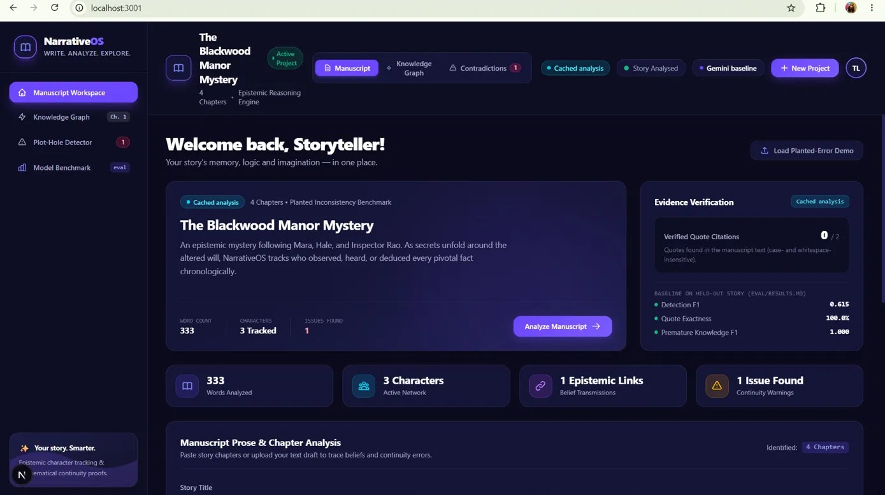
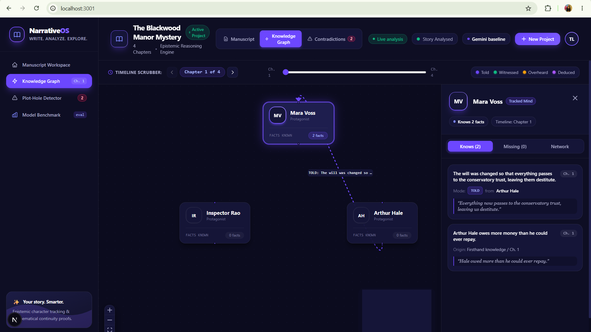
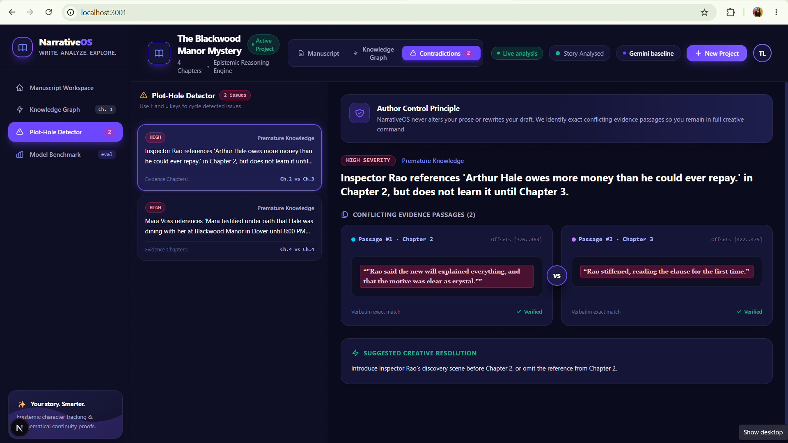
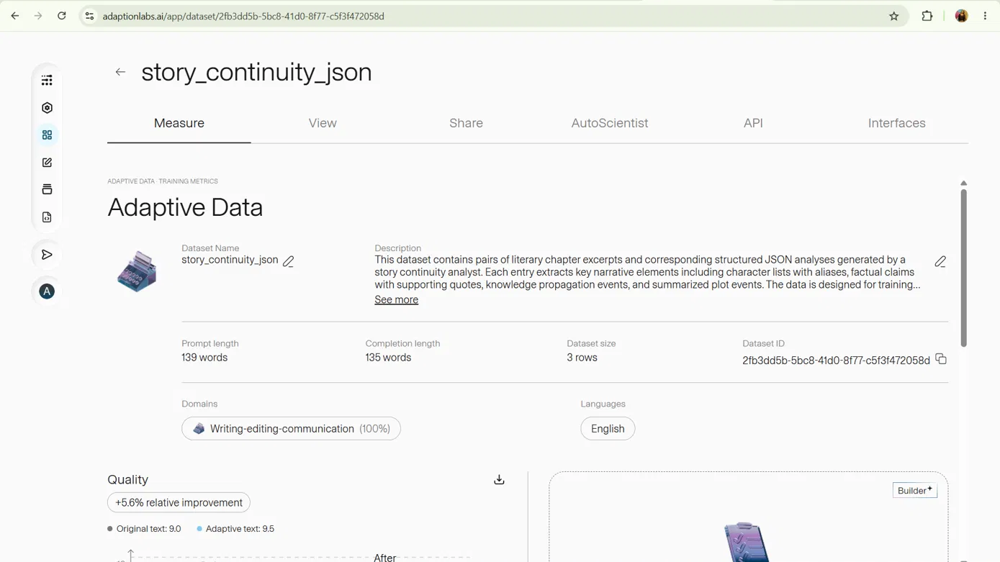
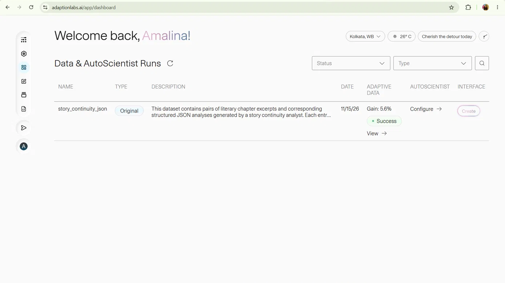
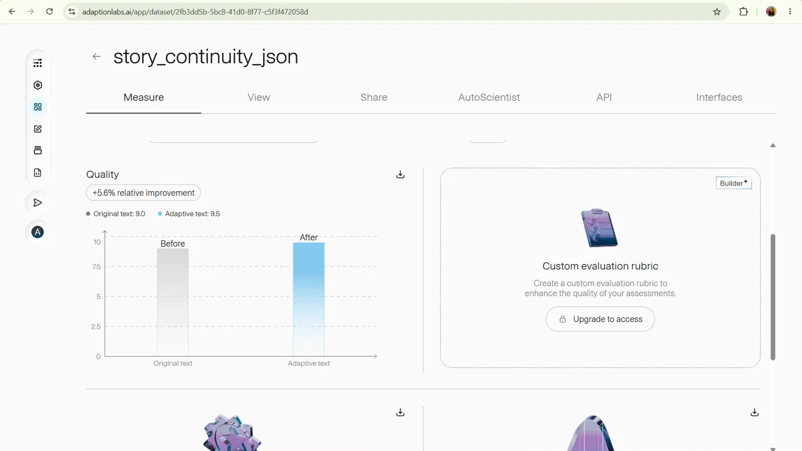

# NarrativeOS — Deployment & Final Submission Guide

**Hackathon:** GeNarrative Clash 2026  
**Track:** Storytelling & Co-Writers  
**Portal:** `generative-clash-2026.web.app` (Submitted by Team Lead: @amalinaguin-2006)  
**Submission Cutoff:** Monday Nov 16, 2026

---

## 1. Cloud Deployment Setup

### Frontend: Vercel (Recommended)
1. Go to [vercel.com](https://vercel.com) and log in with GitHub.
2. Click **Add New... -> Project** and select `shreejato/who-knew-what`.
3. Set **Root Directory** to `web`.
4. Configure Environment Variables (names only):
   - `NEXT_PUBLIC_API_URL`: URL of your deployed backend service.
   - `NEXT_PUBLIC_USE_MOCK`: Set to `false` for live backend connectivity.
5. Click **Deploy**.

### Backend: Render or Railway (Recommended)
#### Option A: Render
1. Go to [render.com](https://render.com) -> New **Web Service**.
2. Connect `shreejato/who-knew-what`.
3. Set **Root Directory** to `api`.
4. Build Command: `pip install -r requirements.txt`
5. Start Command: `uvicorn app.main:app --host 0.0.0.0 --port $PORT`
6. Configure Environment Variables (names only):
   - `GEMINI_API_KEY`: Your Google AI Studio API key.
   - `EXTRACTOR`: `gemini` (or `adapted` for future pipeline drop-in).
7. Click **Create Web Service**.

---

## 2. Screenshot Artifacts

All screenshots reside in `docs/screenshots/` and are referenced relatively below:

| Screenshot | Relative Path & Preview | Description |
|---|---|---|
| **Manuscript Workspace** |  | Prose analysis view tracking text metrics and chapter boundaries. |
| **Knowledge Graph** |  | Interactive epistemic knowledge graph with chapter timeline scrubber. |
| **Contradiction Detector** |  | Grounded contradiction cards showing exact quotation evidence. |
| **Adaption Dashboard** |  | Adaptive Data platform overview for dataset refinement run. |
| **Adaption Dataset** |  | 3-row extraction seed dataset processed via Adaptive Data. |
| **Adaption Evaluation** |  | Evaluation grade A → A, percentile 43.9 → 57.7, as shown on the Adaption dashboard. |

---

## 3. Verified Repository Facts & Claims

Every claim in the project documentation is grounded in repo artifacts:

### Overall Held-Out Evaluation (`eval/results.md`)
Tested on 6-chapter held-out evaluation story (`data/test_story.txt`) with 8 planted errors (`data/answer_key.json`):

| Metric | Value |
|---|---|
| **Detection F1** | **0.615** |
| **Precision** | 0.800 |
| **Recall** | 0.500 |
| **Quote exactness** | **100.0%** |
| **JSON validity** | 100.0% |
| **Avg latency** | 2.07s |

### Per-Type Breakdown (`eval/results.md`)
| Contradiction Type | Precision | Recall | F1 Score |
|---|---|---|---|
| **premature_knowledge** | 1.000 | 1.000 | **1.000** |
| **attribute** | 1.000 | 0.500 | **0.667** |
| **presence** | 0.500 | 0.500 | **0.500** |
| **timeline** | 0.000 | 0.000 | **0.000** |

- **Adaption Pilot (`data/adaption/adaption_state.json`):** Dataset ID `2fb3dd5b-5bc8-41d0-8f77-c5f3f472058d`, 3 rows in / 3 rows out, Grade A → A, Score 9.0 → 9.5 (+5.6% relative), Percentile 43.9 → 57.7. This was strictly an Adaptive Data seed-data pilot, **not a fine-tuned model**.
- **Data-Source Honesty:** UI badge indicates `Built-in sample (mock)`, `Cached analysis`, or `Live analysis`. When previously analyzed text is requested, the backend serves cached extractions of a real Gemini run.
- **Frontend Stack (`web/package.json`):** Next.js `16.4.6`, React `19.3.0`, React DOM `19.3.0`, `@xyflow/react` `^12.12.1`, Tailwind CSS `^4.3.3`, `@tailwindcss/postcss` `^4.3.5`.
- **Backend Stack (`api/requirements.txt`):** Python (3.12, per `render.yaml`), `fastapi`, `uvicorn[standard]`, `pydantic`, `python-dotenv`, `python-multipart`, `python-docx`, `google-genai`, `pytest`, `httpx`.

---

## 4. Pre-Submission Verification Checklist

Run this full checklist in an **Incognito / Private Window** before submitting:

- [ ] **GitHub Repository:**
  - Public repository: `https://github.com/shreejato/who-knew-what`
  - README renders cleanly on GitHub with Mermaid diagrams and tables.
  - All screenshots load properly from `docs/screenshots/`.
  - Zero API keys or secrets in repo or git history (verify with `git log -p -S"AIza"`).
  - `.env` and `web/.env.local` are present in `.gitignore` and untracked.
- [ ] **Demo Video:**
  - Link: `TODO: add demo video link`
  - Length between 2:00 and 4:00 minutes.
  - Set to **Public** or **Unlisted** (if YouTube), or **Anyone with the link can view** (Drive/Loom).
  - Video and audio stream cleanly without authentication.
- [ ] **Mandatory Forms Completed:**
  - Giveaway Form: `https://forms.gle/uMxYcJh1Rv9DZ4Uv6`
  - Adaption Verification Form: `https://forms.gle/KpRStgBbxjSUz6UR8`
- [ ] **Team Information:**
  - Member 1: Saptadeepa Dutta (@saptadeepa823)
  - Member 2: Prantik Mondal (@prantikmondal433-hub)
  - Member 3: Shreejato Ghosh (@shreejato)
  - Member 4: Amalina Guin (@amalinaguin-2006)
- [ ] **Held-Out Test Data Intact:**
  - `data/test_story.txt` and `data/answer_key.json` strictly preserved as un-leaked held-out evaluation data.
- [ ] **Final Submission Submitted by Team Lead:**
  - Submitted on `generative-clash-2026.web.app` before the cutoff.
